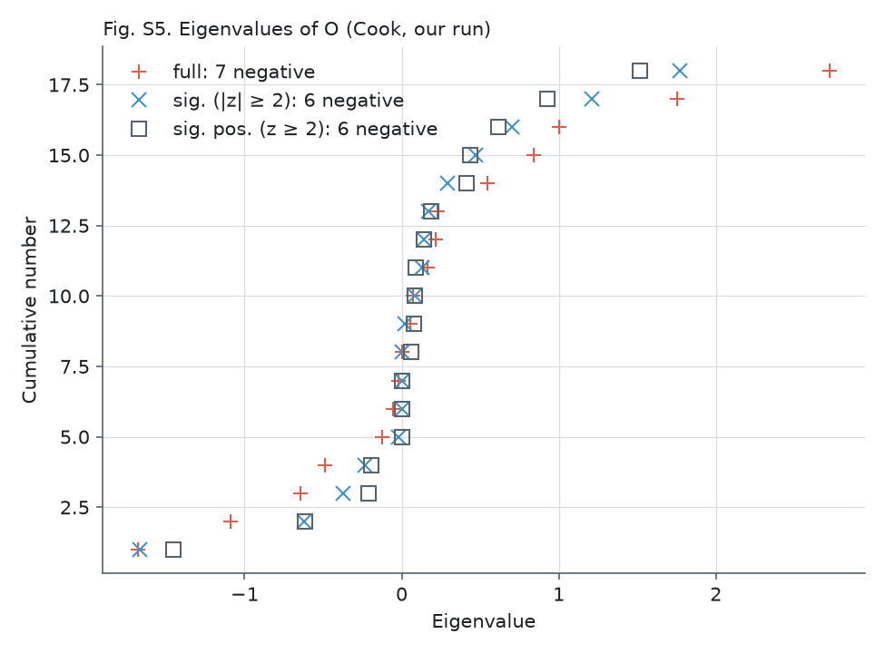
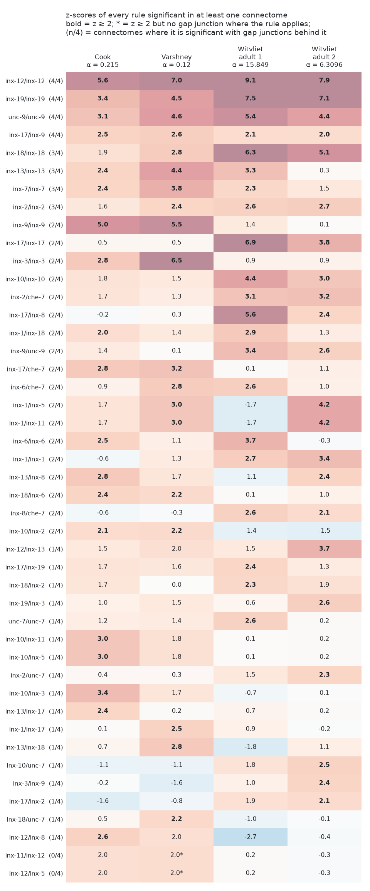

# SCM results (alpha = 0.215, Cook GJ connectome, 185 anterior neurons)

Code: `src/scm.py` (Python 3 port of the authors' SCM_alpha*.py), `src/alpha_matrix.cpp` (authors' randomization, unchanged),
`src/build_cook_B.py` (rebuilds B from Cook 2019 SI 5). Compile: `g++ -O3 -o results/bin/alpha_matrix.out src/alpha_matrix.cpp`.

| Run | Folder | Result |
|-----|--------|--------|
| Authors' B, C, X | `authors_inputs/` | Matches the authors' `rule_matrix_0.2150.csv` and z-scores to ~1e-12. 19 positive rules with z >= 2, as in the paper. 7 negative eigenvalues of the symmetrized O. |
| Varshney B (rebuilt from `ConnOrdered_040903.mat`, identical to the authors' `CEO_Gap_OnlyContact.csv`; 301 links), alpha = 0.12 as in SI Fig. S4 | `varshney/` | Matches SI Fig. S4 to its printed precision (O within 0.005, z within 0.05). 21 rules with z >= 2, 11 shared with Cook. 6 negative eigenvalues. |
| Rebuilt Cook B (SI 5, binarized, masked by C; 602 links) with authors' C and X | `cook_rebuilt/` | 19 rules, 14 shared with the authors' set. Correlation of O with the authors' O: 0.973 (mean abs diff 0.031, max 0.374). |

The authors' B is the WormWiring Cook edge list, not SI 5: `src/build_cook_B_wormwiring.py` rebuilds it with 0 differences
(see `data/raw/SOURCES.md`), so the `authors_inputs/` run is also the run on B rebuilt from raw data. The `cook_rebuilt/` run
shows how much the rules change between the two Cook releases.

Rebuilt-B (SI 5) differences (all near the z = 2 cutoff):
- Lost: inx-1/inx-18 (z 1.6), inx-10/inx-2 (1.9), inx-13/inx-13 (1.4), inx-6/inx-6 (1.7), inx-7/inx-7 (1.9)
- Gained: inx-11/inx-12 (2.1), inx-12/inx-5 (2.1), inx-13/inx-7 (2.0), inx-17/inx-19 (2.3), inx-7/unc-7 (2.2)
- Strong rules are stable: inx-12/inx-12, inx-9/inx-9, inx-10 with inx-11, inx-3, inx-5, inx-19/inx-19, unc-9/unc-9.

## Gene order

Rows and columns of every `rule_matrix_*.csv` and `zscores_*.csv` (and the columns of X) follow SI Figs. S3/S4:
inx-1, inx-10, inx-11, inx-12, inx-13, inx-17, inx-18, inx-19, inx-2, inx-3, inx-5, inx-6, inx-7, inx-8, inx-9, che-7, unc-7, unc-9.
(inx-5 and inx-11 have identical expression in X, so their rows are identical.)

The `authors_inputs/` run matches SI Fig. S3 to its printed precision (O within 0.005, z within 0.05).

## Varshney robustness run (SI text, Fig. S4)

The paper reports 12 rules shared between Cook and Varshney. We reproduce all 12; 11 have z >= 2 in both runs, and the 12th,
inx-8/inx-12, has Varshney z = 1.96, which SI Fig. S4 prints as 2.0. No other rules are shared.

| Shared rule | Cook z | Varshney z |
|-------------|--------|------------|
| inx-12/inx-12 | 5.61 | 7.04 |
| inx-9/inx-9 | 5.00 | 5.53 |
| inx-3/inx-3 | 2.83 | 6.51 |
| unc-9/unc-9 | 3.15 | 4.55 |
| inx-19/inx-19 | 3.44 | 4.49 |
| inx-13/inx-13 | 2.40 | 4.44 |
| inx-7/inx-7 | 2.36 | 3.85 |
| che-7/inx-17 | 2.84 | 3.19 |
| inx-9/inx-17 | 2.45 | 2.65 |
| inx-6/inx-18 | 2.42 | 2.16 |
| inx-2/inx-10 | 2.09 | 2.16 |
| inx-8/inx-12 | 2.57 | 1.96 |

- Cook only: inx-1/inx-18, inx-10/inx-11, inx-10/inx-3, inx-10/inx-5, inx-13/inx-17, inx-13/inx-8, inx-6/inx-6 (plus inx-8/inx-12 above).
- Varshney only: inx-1/inx-11, inx-1/inx-17, inx-1/inx-5, inx-11/inx-12, inx-12/inx-5, inx-13/inx-18, inx-18/inx-18, inx-18/unc-7, inx-2/inx-2, inx-6/che-7.
- Correlation of the two O matrices: 0.82 (z-scores: 0.83). Varshney has half as many links (301 vs 601), so it is the noisier fit.
- `varshney/*_0.2150.*` is the same run at the Cook alpha for comparison: 20 rules, the same 11 shared.

## SI figures (`figures/`)

`src/plot_si_figures.py` recreates SI Figs. S2-S6 from our data (S1 is a schematic). `src/check_against_si.py` reads the
tables printed in the SI PDF and compares them with ours: all 6 match to the printed precision (Fig. S3 Cook rules and
z-scores, Fig. S4 Varshney rules and z-scores, Fig. S6 Cook and Varshney Moore-Penrose solutions).

| Figure | File | Result |
|--------|------|--------|
| S2 alpha selection | `figS2_alpha_selection.png`, `alpha_scan_*.csv` | Generalized cross-validation minimum at alpha = 0.215 for Cook (r²/τ² = 8.5503e-6, as in the authors' `workfile.txt`) and at 0.120 for Varshney, the value used in Fig. S4. The Varshney curve is not in the SI. |
| S3 Cook rules | `figS3_cook_rules.png` | Matches the SI table. |
| S4 Varshney rules | `figS4_varshney_rules.png` | Matches the SI table. |
| S5 eigenvalues of O (Cook) | `figS5_eigenvalues.png` | "full" (7 negative) and "sig. pos." (6 negative) match the SI points. "sig." (\|z\| >= 2) matches in 17 of 18 points: we have one eigenvalue at -1.67 where the SI has a fourth zero. Cause not found; dropping one or two significant rules does not reproduce it. The spectrum is indefinite either way, as the paper states. |
| S6 Moore-Penrose (alpha -> 0) | `figS6_moore_penrose.png`, `rule_matrix_MP_*.csv` | Both tables match the SI. |

### Fig. S2: choosing alpha

### Fig. S3: Cook rules and z-scores

### Fig. S4: Varshney rules and z-scores

### Fig. S5: eigenvalues of O

### Fig. S6: Moore-Penrose solutions

Explanations of the terms and the procedure: [`supplementary/README.md`](../supplementary/README.md).

## Independent replication: Witvliet et al. 2021 adults

**Why it is needed.** Cook and Varshney are two tracings of the same electron-microscopy images of the White et al.
1986 animals, so their agreement mostly measures how consistently two groups annotate the same worms, not whether the
rules hold in other worms. A genetic rule should appear in every individual.

**The data.** Witvliet et al. 2021 (*Nature*, "Connectomes across development reveal principles of brain maturation")
imaged the nerve ring of 8 new hermaphrodites, from newborn L1 larvae to adults, with serial-section electron
microscopy, and traced every neuron and synapse in it. We use the two adults: different animals, a different lab, newer
methods. Keeping them separate also gives a baseline for worm-to-worm variation: the two adults share 157 gap-junction
links (63% of adult 1's, 55% of adult 2's), about as much overlap as Cook and Varshney (Jaccard 0.42 vs 0.40).

Same 185 neurons and the authors' C and X; only B changes. The three kinds of comparison:

| Comparison | What differs | What it tests |
|------------|--------------|---------------|
| Cook vs Varshney | annotation of the same images | consistency of tracing |
| Witvliet adult 1 vs 2 | the animal | worm-to-worm variation |
| Cook/Varshney vs Witvliet | animals, lab, methods | all of the above |

- **B** (`src/build_witvliet_B.py`): electrical synapses, symmetrized, binarized, masked by C. 180 of the 185 neurons
  are in the data (missing: the ventral-cord motor neurons SABD, VB01, VB02, VC01, VD01). Adult 1: 250 links (17
  outside C removed); adult 2: 283 links (21 removed). Fewer gap junctions than Cook (601), similar to Varshney (301).
- **alpha** (`src/select_alpha.py`): the cross-validation minimum is at alpha = 15.85 (adult 1) and 6.31 (adult 2), far
  above Cook's 0.215, but the curves are flat: the score at 0.215 is within 1%. Results are shown at both choices.
  A large alpha does not mean worse data. At alpha = 0.215 the model ranks real gap junctions above non-connections
  about equally well in all four (AUC 0.64 Cook, 0.69 Varshney, 0.65 and 0.66 Witvliet; 0.71-0.76 among pairs where
  both neurons express an innexin). The flexibility of a small alpha mainly helps rules of rare genes, and the
  Witvliet animals have almost no gap junctions on those neurons (none for inx-3/inx-3 or inx-10/inx-2), so
  cross-validation prefers to shrink.
- **Comparison** (`src/compare_connectomes.py`): `connectome_comparison_{gcv,fixed}.csv` and
  `figures/rules_across_connectomes_{gcv,fixed}.png`. A rule counts as replicated if z >= 2 and at least one gap
  junction exists among the touching neuron pairs it applies to (see caveat 1).

| | alpha = 0.215 for all | each at its cross-validated alpha |
|---|---|---|
| Of Cook's 19 rules, significant in Witvliet adult 1 / 2 | 8 / 5 | 8 / 5 |
| Of the 12 Cook-and-Varshney rules, significant in Witvliet adult 1 / 2 | 6 / 4 | 6 / 4 |
| Significant in all four connectomes | inx-12/inx-12, inx-19/inx-19, unc-9/unc-9, inx-7/inx-7 | inx-12/inx-12, inx-19/inx-19, unc-9/unc-9, inx-9/inx-17 |
| Significant in 3 of 4 | inx-13/inx-13, inx-18/inx-18, inx-2/inx-2, inx-9/inx-9 | inx-13/inx-13, inx-18/inx-18, inx-2/inx-2, inx-7/inx-7 |
| Negative rules (z <= -2) in 3 or 4 | inx-9/inx-12, inx-9/inx-13, inx-10/inx-13, inx-3/inx-13 | inx-9/inx-12, inx-9/inx-13, inx-2/inx-13 |
| z-score correlation: Cook-Varshney / Witvliet 1-2 / across | 0.83 / 0.75 / 0.58-0.65 | 0.83 / 0.73 / 0.50-0.55 |

**Findings.**
- The strongest rules replicate in new animals: inx-12/inx-12, inx-19/inx-19 and unc-9/unc-9 are significant in all
  four connectomes at both alpha choices, and inx-7/inx-7, inx-13/inx-13, inx-18/inx-18 and inx-2/inx-2 in at least 3.
- Nearly all replicated rules are same-gene (homotypic). The only different-gene rule in all four is inx-9/inx-17, and
  only at the cross-validated alpha. Most of Cook's heterotypic rules (e.g. inx-10 with inx-2, inx-3, inx-5, inx-11) are
  not significant in Witvliet.
- The two Witvliet adults agree with each other (r = 0.73-0.75) about as well as Cook and Varshney do (0.83), but less
  with Cook and Varshney (0.50-0.65): part of what Cook and Varshney share may come from the shared animals.
- Two avoidance rules replicate at both alphas: inx-9/inx-12 and inx-9/inx-13.
- Rules significant in exactly 2 of 4 mostly split by family of data: of 18 such rules (cross-validated alpha), 7 are
  significant only in the two Witvliet adults and 5 only in Cook and Varshney. Most involve rare genes, where a few gap
  junctions decide the result: inx-10/inx-2 has 4 and 3 gap junctions in Cook and Varshney (z = 2.1, 2.2) and none in
  either Witvliet adult (z = -1.4, -1.5). A rule with no gap junctions where chance expects some gets a negative z.
  Rules from rare genes and few gap junctions should be treated as unconfirmed.

**Caveats.**
1. **Significance without direct evidence.** At alpha = 0.215, inx-3/inx-3 has z = 2.3 and 2.4 in the Witvliet adults
   although none of the 19 touching pairs of inx-3 neurons has a gap junction. The weight comes indirectly from the
   regression (offsetting other rules that apply to the same neurons). It disappears at the cross-validated alpha.
   Such cells are marked * and not counted as replicated. Varshney's inx-11/inx-12 and inx-5/inx-12 (z = 2.0) are of
   this kind too.
2. **Left/right partners.** Most neurons come in mirror-image left/right pairs of the same class (e.g. AVAL and AVAR,
   see `supplementary/README.md`). X is per neuron class, so all 83 left/right pairs among the 185 neurons have
   identical expression, and partners often share a gap junction. Of the gap junctions between two neurons expressing the same
   gene, 13-24% (unc-9) to 30-45% (inx-19) are between partners. Same-gene rules may therefore partly reflect "left and
   right partners connect" rather than innexin docking.
3. **C comes from the old animals.** Contacts differ between individuals; 17 and 21 Witvliet gap junctions fall
   outside C and are dropped.
4. **Less data.** With half as many gap junctions as Cook, weak rules can fail to replicate for lack of power.
