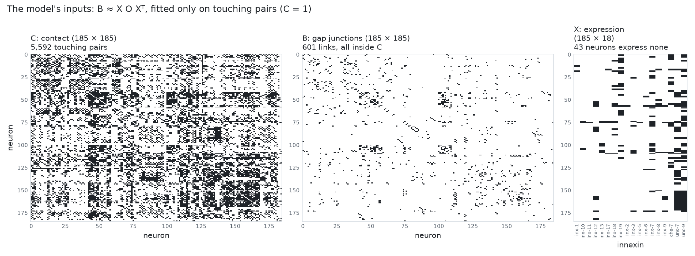
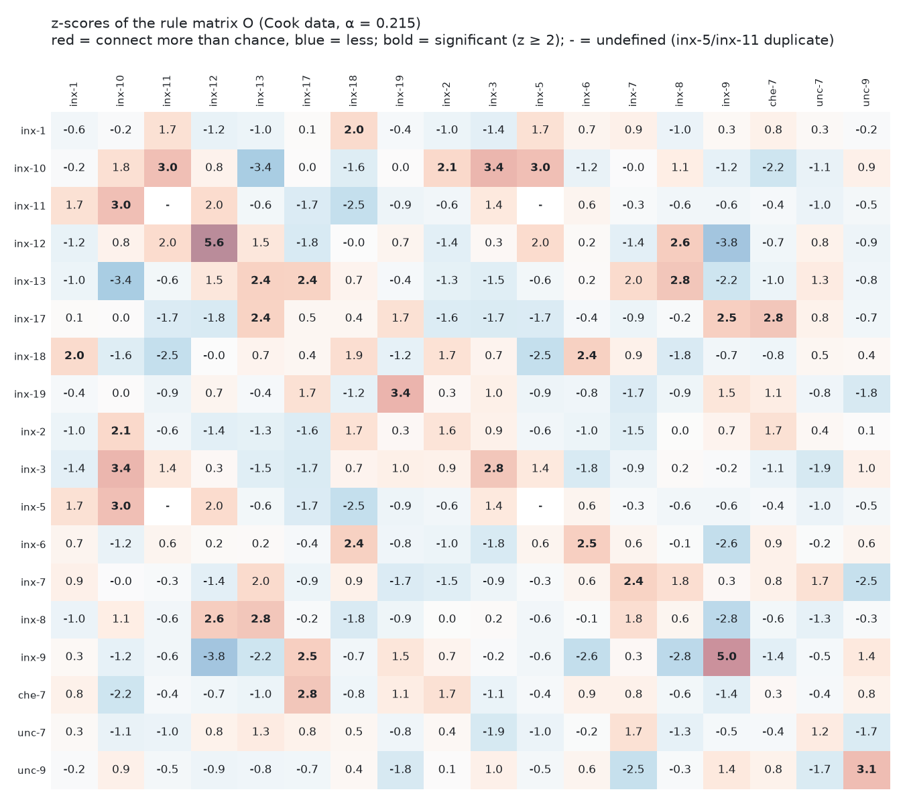
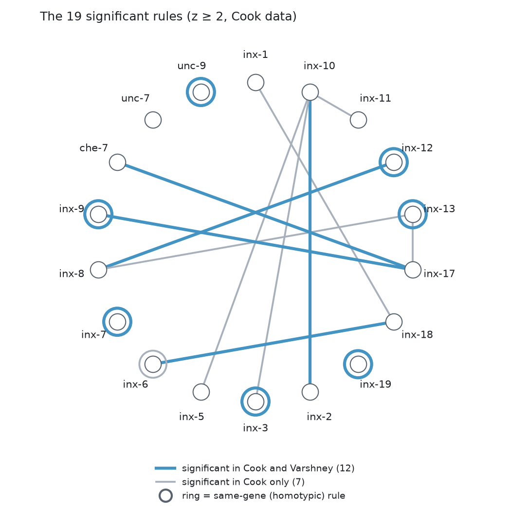
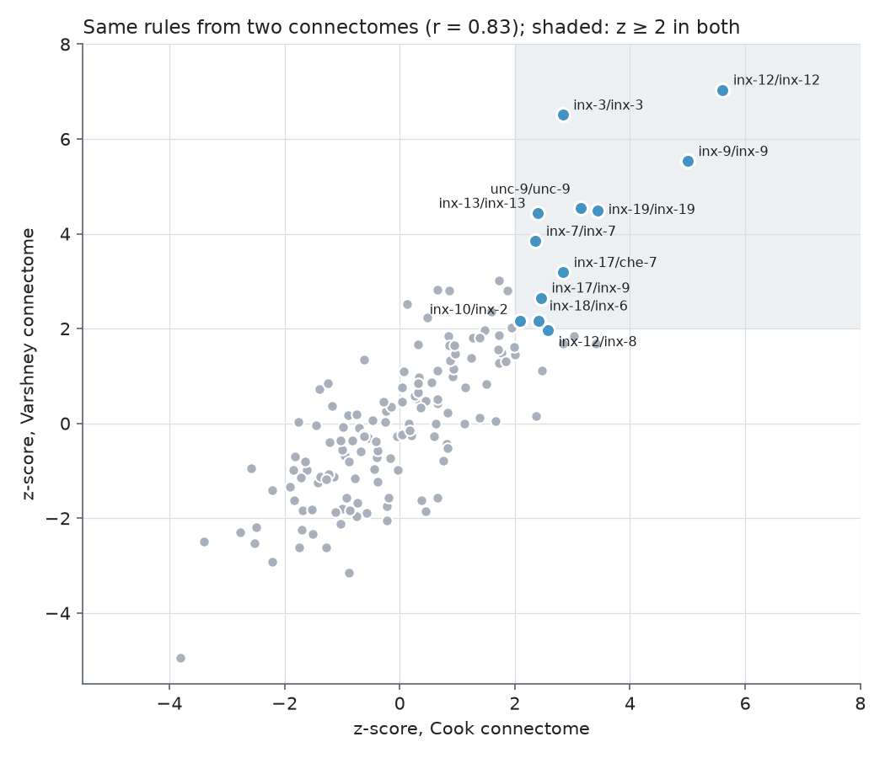
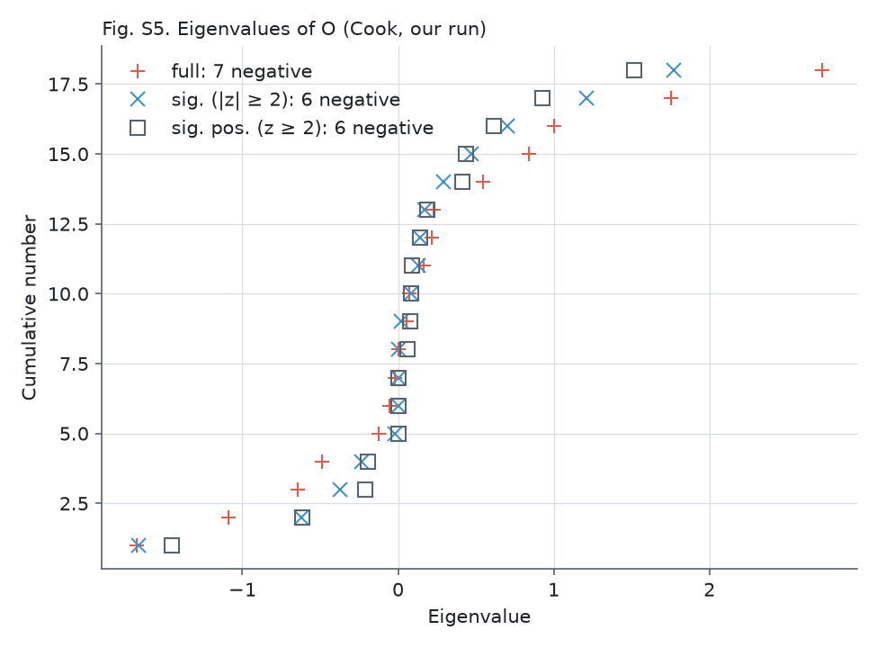
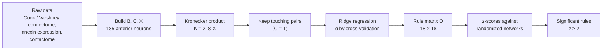
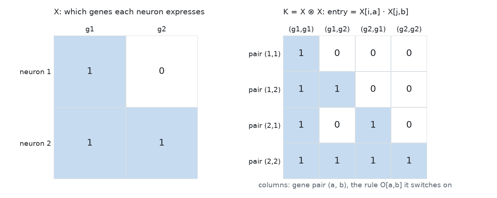
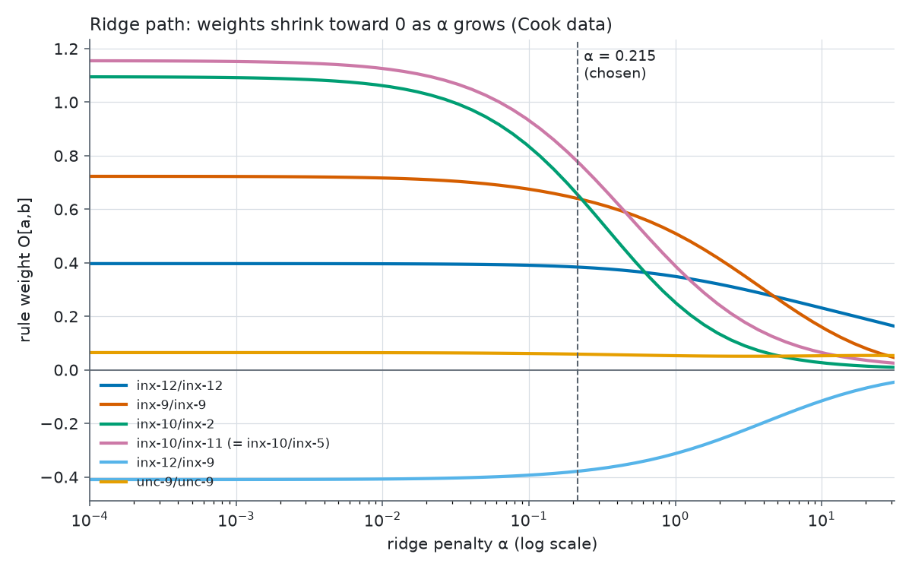

# Supplementary information

Background for this reproduction of Kovács, Barabási & Barabási (2020), *Uncovering the genetic blueprint of the
C. elegans nervous system*, PNAS 117(52). What the model does, how it is solved, where the data come from, and the
terms used throughout. Results are in [`results/README.md`](../results/README.md).

**The question:** which pairs of innexin genes decide which neurons form gap junctions?

**The idea:** if neurons expressing gene *a* tend to connect to neurons expressing gene *b*, that one rule leaves a
footprint in the connectome: a block of connections between the two groups (a biclique). Working backwards from the
connectome and gene expression, the model recovers the rules.

## Graphics



**The model's inputs (Cook data).** C says which of the 185 neurons touch, B which pairs share a gap junction (every
gap junction is inside C), and X which of the 18 innexins each neuron expresses. Black = 1.



**The output: z-scores of O (as in SI Fig. S3).** One cell per pair of genes; the table is symmetric, so each rule
appears twice (row *a*, column *b* and row *b*, column *a*). Red cells connect more than chance, blue cells less. The 19
bold cells in the upper half are the significant rules (z ≥ 2). Some cells print as 2.0 but are 1.96-1.99 and are not
bold. The four "-" cells are undefined: inx-5 and inx-11 are expressed only in DVC, so rules among them have no variance.



**The 19 significant rules as a network.** This draws the bold cells of the table above. Each gene is a dot on the
circle, and each significant rule is a line between its two genes (heterotypic, e.g. inx-9/inx-17) or a ring around
one gene (homotypic, e.g. inx-12/inx-12: neurons expressing inx-12 tend to connect to other neurons expressing
inx-12). Blue rules are also significant in the independent Varshney connectome (12); gray ones only in Cook (7).
- **Same-gene rules dominate the reproducible set:** 7 of the 12 blue rules are rings (inx-3, -7, -9, -12, -13, -19,
  unc-9), consistent with hemichannels of the same innexin docking with each other.
- **inx-10 is a hub:** it has rules with inx-2, inx-3, inx-5 and inx-11, but only inx-2/inx-10 holds up in Varshney.
- **unc-7 has no significant rule** although it is expressed in 65 neurons; common genes are hard to tell apart from
  chance.
- **Lines are only positive rules.** Significant negative rules (e.g. inx-9/inx-12, z = -3.8: neurons expressing these
  avoid connecting) are in the table but not drawn.



**Robustness.** Each dot is one of the 171 gene pairs. The z-scores agree between the two connectomes (r = 0.83), and
12 rules are significant in both.

### Reading O and its z-scores

Both tables use the same grid: row = gene *a*, column = gene *b*. Both are symmetric (gap junctions have no direction),
so every rule appears twice.

**A cell of O** is how much this gene pair adds to the chance that two touching neurons form a gap junction, when one
expresses gene *a* and the other gene *b*. The prediction for a neuron pair adds up every rule that applies:

> Neuron *i* expresses {inx-12, unc-9} and neuron *j* expresses {inx-12}. Two rules apply:
> O[inx-12, inx-12] + O[unc-9, inx-12] = 0.38 + (−0.03) = **0.35**, a fairly likely gap junction if they touch.

Positive (red): such neurons connect more often. Negative (blue): they connect less often, even when touching (e.g.
inx-9/inx-12 = −0.38). Diagonal cells are same-gene (homotypic) rules.

**A cell of the z-score table** asks how surprising that weight is: how many standard deviations O[a, b] is from its
value if the wiring were random (same contacts, same number of gap junctions per neuron). Weight and z-score answer
different questions and can disagree:

| Rule | O (strength) | z (reliability) | Why |
|------|--------------|-----------------|-----|
| inx-10/inx-10 | 0.42, large | 1.8, not significant | Only 4 neurons express inx-10, so the estimate is noisy |
| unc-9/unc-9 | 0.06, tiny | 3.1, significant | 85 neurons express unc-9, so even a small effect is consistent |

O says how strong a rule is; z says how sure we are that it is real.

### Reading the eigenvalue plot (SI Fig. S5)



O is an 18 × 18 symmetric matrix, so it has 18 real eigenvalues. Each one belongs to an eigenvector v, a weighting of
the 18 genes, and O can be rebuilt from them: O = Σ λ v vᵀ. Each eigenvector gives every neuron a score, s = X v, from
the genes it expresses, and that eigenvector's contribution to the predicted connection between neurons *i* and *j* is
λ s<sub>i</sub> s<sub>j</sub>.

- **Axes.** x is the eigenvalue. y is its rank: the 18 eigenvalues are sorted from smallest to largest, so the point at
  y = 5 is the 5th smallest. Read it like a cumulative count: the y value where the points cross x = 0 is the number of
  negative eigenvalues.
- **Positive eigenvalue: "similar neurons connect".** λ > 0 rewards pairs whose scores have the same sign, so neurons
  with similar expression along v are predicted to connect.
- **Negative eigenvalue: "complementary neurons connect".** λ < 0 rewards pairs with opposite signs: neurons expressing
  one group of genes connect to neurons expressing a different group, and avoid their own kind.
- **Why the negatives matter.** If every eigenvalue were positive, all wiring could be explained by similarity of
  expression. Cook's O has 7 negative eigenvalues (the paper says at least 4), and the most negative, -1.68, is close in size
to the largest positive ones (1.75 and 2.73), so
  complementarity is a real part of the rules, not noise. This is the paper's point that neurons often connect to
  neurons that express different innexins.
- **Size matters more than count.** Eigenvalues near 0 (the middle of the curve) contribute almost nothing; one is
  exactly 0 because the inx-5 and inx-11 rows of O are identical.
- **Three series.** "full" uses all of O; "sig." keeps only entries with |z| ≥ 2; "sig. pos." only entries with z ≥ 2
  (the 19 rules). Negative eigenvalues remain even in "sig. pos.", so they are not produced by the negative entries of
  O: a set of only positive rules between different genes is already complementary. One "sig." point differs from the
  SI (see [`results/README.md`](../results/README.md)).

## Procedure

A short overview; the Kronecker product, ridge regression and the code are explained step by step in
[The code in detail](#the-code-in-detail).



**1. Model.** Two neurons *i* and *j* are predicted to connect according to the genes they express:

$$B_{ij} \approx \sum_a \sum_b X_{ia}\, O_{ab}\, X_{jb}, \quad\text{i.e. } B \approx X O X^\mathsf{T}$$

X<sub>ia</sub> is 1 if neuron *i* expresses gene *a*. The sum runs over all 18 × 18 = 324 gene pairs and adds up the rule
weights O<sub>ab</sub> that apply to this neuron pair.

**2. Make it a linear regression.** O appears between two copies of X, so the model is not in the usual form
y = Xβ. Flattening B into a vector b (34,225 neuron pairs) and O into o (324 rules) and using the Kronecker product
K = X ⊗ X gives **b = K o**: one row per neuron pair, one column per gene pair.

**3. Keep only touching pairs.** Neurons that do not touch cannot form a gap junction, so those pairs say nothing about
the rules. Deleting their rows (where C<sub>ij</sub> = 0) leaves **b′ = K′ o** with 11,149 rows. This is the "spatial"
part of the Spatial Connectome Model.

| Step | Object | Size |
|------|--------|------|
| Model | B = X O Xᵀ | 185 × 185 |
| Flatten | b = vec(B), o = vec(O) | 34,225 and 324 |
| Kronecker | K = X ⊗ X, b = K o | 34,225 × 324 |
| Contact filter | b′ = K′ o (rows with C = 1) | 11,149 × 324 |
| Ridge solve | o = (K′ᵀK′ + αI)⁻¹ K′ᵀ b′ | 324 → 18 × 18 |

**4. Solve with ridge regression.** Ordinary least squares, o = (K′ᵀK′)⁻¹K′ᵀb′, fails because K′ᵀK′ cannot be
inverted:
- **Duplicate genes.** inx-5 and inx-11 are both expressed only in neuron DVC, so their columns are identical and the
  data cannot tell them apart.
- **Rare genes.** Five genes are expressed in 4 neurons or fewer (inx-5 and inx-11 in one), so a single noisy pair can
  push their rules to extreme values.

Ridge regression adds a penalty on large weights, minimizing ‖b′ − K′o‖² + α‖o‖², which gives
**o = (K′ᵀK′ + αI)⁻¹ K′ᵀ b′**. Adding α to the diagonal makes the matrix invertible. The penalty splits tied credit
equally (so the inx-5 and inx-11 rows of O are identical) and shrinks weakly supported rules toward 0.

**5. Choose α.** α is chosen by generalized cross-validation: the α that minimizes r²/τ² (see the glossary), which
estimates how well the model would predict data it has not seen. The minimum is at **α = 0.215 for Cook** and
**α = 0.12 for Varshney** ([`results/figures/figS2_alpha_selection.png`](../results/figures/figS2_alpha_selection.png)).

**6. Test significance.** A large weight could be a coincidence, for example if a gene is common among neurons that
happen to touch many others. To test this, the connectome is compared with randomized versions that keep each neuron's
number of gap junctions and only place gap junctions between touching neurons (subgraph randomization):

1. **Link probabilities under chance.** `alpha_matrix.cpp` does not generate random networks. It computes the
   probability of a link between each touching pair in the maximum-entropy random ensemble,
   p<sub>ij</sub> = 1 / (1 + α<sub>i</sub>α<sub>j</sub>), with one parameter per neuron fitted in 100 iterations so
   that each neuron keeps its number of gap junctions on average. (This α is unrelated to the ridge α.)
2. **Mean and variance of O.** The fitted rules are a fixed matrix times the connections, O = A b′ with
   A = (K′ᵀK′ + αI)⁻¹K′ᵀ. If each link is an independent coin flip with probability p<sub>ij</sub>, then
   mean(O) = A p and var(O) = A² p(1 − p), exactly (`randomized_moments` in `src/scm.py`).
3. **z-score.**

$$z_{ab} = \frac{O_{ab} - \text{mean}(O^\text{rand}_{ab})}{\text{sd}(O^\text{rand}_{ab})}$$

A rule is called significant if **z ≥ 2**, the paper's threshold, which counts only rules that connect *more* than
chance. That is a **one-sided** test: if z is roughly normal, z ≥ 2 corresponds to p ≈ 0.023 (|z| ≥ 2, two-sided, would
be p ≈ 0.046). Cook gives 19 such rules. Two caveats: no p-values are computed (the normal approximation is assumed), and
there is no correction for testing 171 gene pairs, so about 4 of the 19 could pass by chance. The paper uses z to rank
rules for experimental validation; agreement between two connectomes (step 7) is the stronger test.

**7. Robustness.** Steps 2–6 are repeated on the Varshney connectome, a separate reconstruction from the same
electron-microscopy images. The question is not whether the numbers are identical but whether the same rules come out
significant: 12 do.

## The code in detail

### The Kronecker product

**Why it is needed.** In B = X O Xᵀ the unknown O sits between two copies of X, so the model is *bilinear*, not the
y = Xβ form that regression can solve. The Kronecker product rewrites it so that O is a single vector of unknowns.

**Definition.** For X with one row per neuron and one column per gene, K = X ⊗ X has one row per *neuron pair* (i, j)
and one column per *gene pair* (a, b), with

$$K_{(i,j),(a,b)} = X_{ia}\, X_{jb}$$

The entry is 1 only when neuron *i* expresses gene *a* and neuron *j* expresses gene *b*, i.e. when rule O[a,b] applies to
that neuron pair. Flattening B and O row by row gives vec(X O Xᵀ) = (X ⊗ X) vec(O), so **b = K o**: an ordinary linear
regression with K as the design matrix.



**Reading the example.** Neuron 1 expresses g1; neuron 2 expresses g1 and g2. The row for pair (1,2) is [1, 1, 0, 0],
so the model predicts b<sub>12</sub> = O[g1,g1] + O[g1,g2]: the two rules that link a g1 neuron to a neuron with g1 or
g2. Pair (2,2) switches on all four rules.

**On the real data (Cook):**

| Quantity | Value | Meaning |
|----------|-------|---------|
| K | 34,225 × 324 | every ordered neuron pair (185²) × every gene pair (18²) |
| K′ (touching pairs only) | 11,149 × 324 | rows where C = 1 |
| Ones in b′ | 1,195 | the 601 gap junctions, each counted as (i,j) and (j,i), except the 7 self-loops |
| Rows of K′ that are all zero | 4,420 | one of the two neurons expresses no innexin; these pairs cannot affect O |
| Columns of K′ that are all zero | 4 | inx-5/inx-11 combinations: their only neuron, DVC, does not touch itself. Weight 0, z undefined (the "-" cells) |
| Touching pairs a rule applies to | unc-9/unc-9: 2,607; inx-12/inx-12: 123; inx-10/inx-10: 13; inx-10/inx-2: 7 | how much data supports each weight |

### Ridge regression

**Why ordinary least squares fails.** Least squares chooses o to minimize ‖b′ − K′o‖², giving
o = (K′ᵀK′)⁻¹K′ᵀb′. That needs K′ᵀK′ (324 × 324) to be invertible, but its rank is only **282**: 42 directions in
the 324 weights are not determined by the data. The causes are the identical inx-5 and inx-11 columns, the 4 empty
columns above, and other gene pairs whose columns are combinations of each other. Infinitely many O fit equally well.

**The fix.** Add a penalty on the size of the weights and minimize

$$\lVert b' - K'o \rVert^2 + \alpha \lVert o \rVert^2$$

Setting the derivative to zero, −2K′ᵀ(b′ − K′o) + 2αo = 0, gives

$$o = (K'^\mathsf{T}K' + \alpha I)^{-1} K'^\mathsf{T} b'$$

Adding α > 0 to every diagonal entry makes the matrix invertible, so there is exactly one answer. Among weights that fit
almost equally well, the penalty picks the smallest: tied genes get equal shares (identical inx-5 and inx-11 rows), and
rules with little data behind them are pulled toward 0.



**Reading the ridge path.** Each line is one rule's weight as α changes (log scale).
- **Left (α → 0):** the weights level off at the Moore-Penrose solution, the same numbers as SI Fig. S6 (e.g.
  inx-10/inx-11 = 1.15, inx-10/inx-2 = 1.10).
- **Right (large α):** every weight is pushed to 0, and the model underfits.
- **At α = 0.215:** rules backed by many touching pairs barely move (unc-9/unc-9, 2,607 pairs; inx-12/inx-12, 123),
  while rules backed by few are shrunk a lot (inx-10/inx-2, 7 pairs: 1.10 → 0.66). This is the penalty doing its job:
  it trusts weights only as far as the data supports them.
- α itself is chosen by generalized cross-validation (step 5 and SI Fig. S2).

### The code, line by line (`src/scm.py`)

| Lines | Code | What it does |
|-------|------|--------------|
| 13 | `k = np.kron(X, X)` | builds K (34,225 × 324) |
| 14 | `kp = k[C.flatten() == 1]` | keeps the touching pairs: K′ (11,149 × 324) |
| 15 | `ka = np.linalg.solve(kp.T @ kp + alpha * I, kp.T)` | the ridge operator A = (K′ᵀK′ + αI)⁻¹K′ᵀ; `solve` is more accurate than inverting the matrix |
| 20 | `bp = B.flatten()[C.flatten() == 1]` | b′: 1 where a touching pair has a gap junction |
| 21 | `(ka @ bp).reshape(18, 18)` | o = A b′, reshaped into the 18 × 18 rule matrix O |
| 29 | `alpha_matrix.out B.txt C.txt 185 100` | the authors' C++ program: link probabilities p<sub>ij</sub> of the random ensemble (100 iterations) |
| 33-34 | `mean = ka @ pp`, `var = (ka * ka) @ (pp * (1 - pp))` | mean and variance of each rule under chance |
| 46 | `z = (O - mean) / np.sqrt(var)` | z-scores; 0/0 for the 4 empty columns gives the "-" cells |

`scm.py` is a Python 3 port of the authors' Python 2 scripts (`SCM_alpha.py`, `SCM_alpha_rnd.py`); the results match
theirs to about 10⁻¹². The α scan of SI Fig. S2 is in `src/plot_si_figures.py`, which computes τ = trace(I − K′A)
without building the 11,149 × 11,149 matrix.

## Data

The authors collected no new data. They combined three published datasets, restricted to the 185 anterior neurons
that all three cover.

| Matrix | Content | Source | How it was measured |
|--------|---------|--------|---------------------|
| B, 185 × 185 | Gap junctions (1 = connected). 601 links for Cook, 301 for Varshney | Cook et al. 2019, *Nature*, via the WormWiring edge list; Varshney et al. 2011, *PLoS Comput Biol* | Electron-microscopy (EM) reconstructions of the White et al. 1986 series. Varshney is the more conservative one. |
| X, 185 × 18 | Which of 18 innexin genes each neuron expresses (0/1) | Altun et al. 2009, *Dev Dyn*, curated to 0/1 (Hobert lab) | Fluorescent reporter for each innexin gene; glowing neurons identified under the microscope. 18 of the 25 innexins have data. |
| B, replication | Gap junctions in two new adult worms. 250 and 283 links among the 185 neurons (180 of them present) | Witvliet et al. 2021, *Nature* | Serial-section EM of the nerve ring of 8 new animals from birth to adulthood; we use the two adults. Independent of the White et al. animals behind Cook and Varshney. |
| C, 185 × 185 | Which neurons touch (1 = touching). 5,592 pairs including 35 self-contacts | Brittin et al. 2018 bioRxiv (*Nature* 2021) | Neuron outlines traced in EM images of the nerve ring; membranes that meet count as touching. |

43 of the 185 neurons (23%) express none of the 18 innexins in X. Some of these are likely missing data rather than
true zeros, which adds noise to the fit.

How each matrix is rebuilt here: [`data/raw/SOURCES.md`](../data/raw/SOURCES.md).

## Innexins: genes and proteins

"Innexin" names a protein family; each innexin protein is made from its own gene. In *C. elegans* the gene is written
in lowercase italics (*inx-9*) and the protein in capitals (INX-9). From gene to connection:

```
inx-9 gene (DNA)
  → transcribed to mRNA → translated to INX-9 protein
  → 8 innexin proteins assemble into a ring in the membrane = a hemichannel
  → hemichannels of two touching neurons dock end to end = one gap junction channel
  → hundreds of channels clustered together = the gap junction seen in electron microscopy
```

Connexins, the vertebrate gap-junction proteins, form hemichannels of 6; innexin hemichannels have 8, as shown by the
structure of *C. elegans* INX-6 (Oshima et al. 2016, *Nat Commun*).

**What X measures.** Altun et al. 2009 used transcriptional reporters: each innexin gene's promoter (its "on switch")
was fused to a fluorescent protein, and the glowing neurons were identified. So X records where each gene is turned on,
not where the protein sits. The model assumes that a gene that is on means the protein is present at that neuron's gap
junctions. Reporters can miss expression, one likely reason 43 neurons show no innexins.

## Glossary

**Biology**
- **Connectome:** the wiring diagram of a nervous system: which neurons connect, and how strongly.
- **Chemical synapse:** a one-way connection that passes signals through neurotransmitters. Not modeled here.
- **Gap junction (GJ):** a direct electrical connection between two touching neurons, made of channels that let ions
  pass both ways. This is what B records.
- **Innexin:** the protein family that forms gap junctions in invertebrates (connexins in vertebrates), each made from
  its own gene. *C. elegans* has 25 innexin genes, most named *inx-1*, *inx-2*, ...; a few kept names from the mutants
  that revealed them (*unc-7*, *unc-9*, *che-7*). 18 are in X. See "Innexins: genes and proteins" above.
- **Hemichannel:** half of a gap junction: a ring of 8 innexin proteins (6 connexins in vertebrates) forming a pore in
  the membrane. A gap junction channel forms when hemichannels from two touching neurons dock. O can be read as a
  hemichannel compatibility score.
- **Homotypic / heterotypic rule:** a rule between the same gene (diagonal of O, e.g. inx-12/inx-12) or two different
  genes (off-diagonal, e.g. inx-9/inx-17).
- **Left/right pair (bilateral homologs):** *C. elegans* is bilaterally symmetric, so most neurons come in mirror-image
  pairs, one on each side. Names are a class plus a side: AVA is a class of command interneurons that drive backward
  movement, AVAL is the left one and AVAR the right one. Some classes have more members (IL1DL, IL1DR, IL1L, IL1R,
  IL1VL, IL1VR; D = dorsal, V = ventral); some neurons are unpaired on the midline (DVA, RIS, PVT). Partners are the
  same cell type with the same genes: all 83 pairs among the 185 neurons have identical rows in X.
- **Contactome:** which neurons physically touch (C).
- **Nerve ring:** the main bundle of neurons in the worm's head, where the contactome was measured.
- **Electron microscopy (EM):** imaging of thin tissue slices at nanometer resolution; how connectomes and contactomes
  are traced.

**Network**
- **Node / edge:** a neuron / a connection between two neurons.
- **Edge list:** a network stored as a list of connections (source, target, weight), instead of a full matrix.
- **Adjacency matrix:** a network stored as a neurons × neurons grid with 1 where two neurons connect (B and C).
- **Degree:** the number of connections a neuron has.
- **Biclique:** two groups of neurons where every neuron in one group connects to every neuron in the other. One
  genetic rule produces one biclique, so 10 neurons expressing inx-12 can yield up to 10 × 10 potential gap junctions.
- **Non-induced biclique:** a biclique where the two groups overlap or contain extra links inside a group; the general
  footprint of a rule (SI Fig. S1).
- **Maximal biclique:** a biclique that cannot be enlarged by adding another neuron.
- **Network motif:** a small connection pattern that appears more often than chance.

**Model and statistics**
- **Spatial Connectome Model (SCM):** B ≈ X O Xᵀ, fitted only on touching pairs.
- **O (rule matrix):** 18 × 18 weights, one per gene pair. Positive: neurons expressing these genes connect more than
  expected. Negative: they connect less, even when touching. The paper reads a positive weight as an estimated
  connection probability (inx-2/inx-10 = 0.66: about 66% of such pairs connect), but they are regression weights, not
  exact probabilities: they can be negative, and several rules add up for the same neuron pair.
- **Kronecker product (X ⊗ X):** a matrix with one row per neuron pair and one column per gene pair, whose entry is 1
  when neuron *i* expresses gene *a* and neuron *j* expresses gene *b*. It turns the model into a linear regression.
- **Ridge regression:** least squares plus a penalty α‖o‖² on large weights. Keeps the solution unique and stable.
- **α (regularization parameter):** the strength of the ridge penalty. Not a significance level. α → 0 is the
  Moore-Penrose solution (SI Fig. S6).
- **Moore-Penrose pseudoinverse:** the least-squares solution with the smallest weights when ordinary least squares has
  no unique answer; the α → 0 limit of ridge regression.
- **Generalized cross-validation (GCV):** a way to choose α without holding out data. The score is r²/τ², where
  **r²** = ‖b′ − K′o‖² is the squared prediction error and **τ** = trace(I − K′(K′ᵀK′ + αI)⁻¹K′ᵀ) is the effective
  number of data points left over after fitting. Too small α overfits (small r², small τ); too large α underfits
  (large r²). The minimum balances the two.
- **Subgraph randomization (maximum-entropy null model):** random versions of the connectome that keep each neuron's
  degree and only connect touching neurons. The authors' `alpha_matrix.cpp` does not sample networks; it computes the
  probability of each link in this ensemble (iterating 100 times to fit each neuron's degree), and the mean and
  variance of O follow directly from those probabilities.
- **z-score:** how many standard deviations a weight is from its value in the randomized networks. The paper's rules
  are those with z ≥ 2 (one-sided, positive only); |z| ≥ 2 is used only for the "sig." series of SI Fig. S5.
- **Eigenvalue (of O):** O has both positive and negative eigenvalues (SI Fig. S5), so the rules cannot be explained by
  "similar neurons connect" alone; some rules join different genes or keep genes apart.
- **Generative model:** a model that explains how data could be produced and can generate new data like it.

## Common questions

- **Why only 185 neurons?** Only these have contact data (the nerve ring), gap-junction data and expression data.
- **Why gap junctions and not chemical synapses?** Innexins are known to form gap junctions; the genes behind chemical
  synapses are less clear, and chemical synapses are directed. The paper leaves them out.
- **Does a 1 in B mean the neurons touch?** No, it means they share a gap junction. Touching is C.
- **Why test the Witvliet worms, and why two of them separately?** Cook and Varshney trace the same images of the same
  1980s animals, so they cannot show whether the rules hold in other worms. Witvliet's adults are new animals. Keeping
  the two separate shows how much rules vary between individual worms, a baseline for judging the comparison with Cook.
- **Can left/right partners bias the rules?** Yes. Partners have identical expression in X and often share a gap
  junction, so one AVAL-AVAR link counts as evidence for every same-gene rule the pair shares. Same-gene rules may partly
  reflect "partners connect" rather than innexin docking; rerunning without partner pairs would test this.
- **Why are the inx-5 and inx-11 rows identical?** Both genes are expressed only in DVC, so the data cannot separate
  them, and ridge regression splits their weight equally.

## Related reading

Barabási & Barabási (2020), *A genetic model of the connectome*, Neuron 105(3). The earlier paper behind the SCM:
neurons that share gene expression form groups, and genetic rules between groups (selective operators) produce
bicliques. The *C. elegans* connectome contains far more large bicliques than degree-preserving random networks do,
which suggests the wiring is genetically encoded rather than random.
