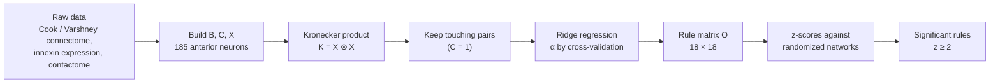

# Supplementary information

Background for this reproduction of Kovács, Barabási & Barabási (2020), *Uncovering the genetic blueprint of the
C. elegans nervous system*, PNAS 117(52). What the model does, how it is solved, where the data come from, and the
terms used throughout. Results are in [`results/README.md`](../results/README.md).

**The question:** which pairs of innexin genes decide which neurons form gap junctions?

**The idea:** if neurons expressing gene *a* tend to connect to neurons expressing gene *b*, that one rule leaves a
footprint in the connectome: a block of connections between the two groups (a biclique). Working backwards from the
connectome and gene expression, the model recovers the rules.

## Graphics

**The model's matrices (Cook data).** C says which of the 185 neurons touch, B which pairs share a gap junction (every
gap junction is inside C), X which of the 18 innexins each neuron expresses, and O is the result: one weight per pair of
genes.

**The 19 significant rules.** Each line joins two genes whose rule has z ≥ 2; a ring marks a same-gene rule. Blue
rules are also significant in the independent Varshney connectome.

**Robustness.** Each dot is one of the 171 gene pairs. The z-scores agree between the two connectomes (r = 0.83), and
12 rules are significant in both.

## Procedure

**1. Model.** Two neurons *i* and *j* are predicted to connect according to the genes they express:

$$B_{ij} \approx \sum_a \sum_b X_{ia}\, O_{ab}\, X_{jb}, \quad\text{i.e. } B \approx X O X^\mathsf{T}$$

Xia is 1 if neuron *i* expresses gene *a*. The sum runs over all 18 × 18 = 324 gene pairs and adds up the rule
weights Oab that apply to this neuron pair.

**2. Make it a linear regression.** O appears between two copies of X, so the model is not in the usual form
y = Xβ. Flattening B into a vector b (34,225 neuron pairs) and O into o (324 rules) and using the Kronecker product
K = X ⊗ X gives **b = K o**: one row per neuron pair, one column per gene pair.

**3. Keep only touching pairs.** Neurons that do not touch cannot form a gap junction, so those pairs say nothing about
the rules. Deleting their rows (where Cij = 0) leaves **b′ = K′ o** with 11,149 rows. This is the "spatial"
part of the Spatial Connectome Model.

| Step | Object | Size |
|------|--------|------|
| Model | B = X O Xᵀ | 185 × 185 |
| Flatten | b = vec(B), o = vec(O) | 34,225 and 324 |
| Kronecker | K = X ⊗ X, b = K o | 34,225 × 324 |
| Contact filter | b′ = K′ o (rows with C = 1) | 11,149 × 324 |
| Ridge solve | o = (K′ᵀK′ + αI)⁻¹ K′ᵀ b′ | 324 → 18 × 18 |

**4. Solve with ridge regression.** Ordinary least squares, o = (K′ᵀK′)⁻¹K′ᵀb′, fails because K′ᵀK′ cannot be
inverted:
- **Duplicate genes.** inx-5 and inx-11 are both expressed only in neuron DVC, so their columns are identical and the
  data cannot tell them apart.
- **Rare genes.** Five genes are expressed in 4 neurons or fewer (inx-5 and inx-11 in one), so a single noisy pair can
  push their rules to extreme values.

Ridge regression adds a penalty on large weights, minimizing ‖b′ − K′o‖² + α‖o‖², which gives
**o = (K′ᵀK′ + αI)⁻¹ K′ᵀ b′**. Adding α to the diagonal makes the matrix invertible. The penalty splits tied credit
equally (so the inx-5 and inx-11 rows of O are identical) and shrinks weakly supported rules toward 0.

**5. Choose α.** α is chosen by generalized cross-validation: the α that minimizes r²/τ² (see the glossary), which
estimates how well the model would predict data it has not seen. The minimum is at **α = 0.215 for Cook** and
**α = 0.12 for Varshney** ([`results/figures/figS2_alpha_selection.png`](../results/figures/figS2_alpha_selection.png)).

**6. Test significance.** A large weight could be a coincidence, for example if a gene is common among neurons that
happen to touch many others. To test this, the connectome is compared with randomized versions that keep each neuron's
number of gap junctions and only place gap junctions between touching neurons (subgraph randomization). This gives the
mean and spread of each Oab under chance, and

$$z_{ab} = \frac{O_{ab} - \text{mean}(O^\text{rand}_{ab})}{\text{sd}(O^\text{rand}_{ab})}$$

A rule is called significant if z ≥ 2 (about p < 0.05 for one entry). Cook gives 19 such rules.

**7. Robustness.** Steps 2–6 are repeated on the Varshney connectome, a separate reconstruction from the same
electron-microscopy images. The question is not whether the numbers are identical but whether the same rules come out
significant: 12 do.

## Data

The authors collected no new data. They combined three published datasets, restricted to the 185 anterior neurons
that all three cover.

| Matrix | Content | Source | How it was measured |
|--------|---------|--------|---------------------|
| B, 185 × 185 | Gap junctions (1 = connected). 601 links for Cook, 301 for Varshney | Cook et al. 2019, *Nature*, via the WormWiring edge list; Varshney et al. 2011, *PLoS Comput Biol* | Electron-microscopy (EM) reconstructions of the White et al. 1986 series. Varshney is the more conservative one. |
| X, 185 × 18 | Which of 18 innexin genes each neuron expresses (0/1) | Altun et al. 2009, *Dev Dyn*, curated to 0/1 (Hobert lab) | Fluorescent reporter for each innexin gene; glowing neurons identified under the microscope. 18 of the 25 innexins have data. |
| C, 185 × 185 | Which neurons touch (1 = touching). 5,592 pairs including 35 self-contacts | Brittin et al. 2018 bioRxiv (*Nature* 2021) | Neuron outlines traced in EM images of the nerve ring; membranes that meet count as touching. |

43 of the 185 neurons (23%) express none of the 18 innexins in X. Some of these are likely missing data rather than
true zeros, which adds noise to the fit.

How each matrix is rebuilt here: [`data/raw/SOURCES.md`](../data/raw/SOURCES.md).

## Glossary

**Biology**
- **Connectome:** the wiring diagram of a nervous system: which neurons connect, and how strongly.
- **Chemical synapse:** a one-way connection that passes signals through neurotransmitters. Not modeled here.
- **Gap junction (GJ):** a direct electrical connection between two touching neurons, made of channels that let ions
  pass both ways. This is what B records.
- **Innexin:** the protein family that forms gap junctions in invertebrates (connexins in vertebrates). *C. elegans*
  has 25 innexin genes (inx-1 to inx-22, che-7, unc-7, unc-9); 18 are in X.
- **Hemichannel:** half of a gap junction. Each neuron assembles innexin subunits into a ring-shaped pore; a gap
  junction forms when hemichannels from two touching neurons dock. O can be read as a hemichannel compatibility score.
- **Homotypic / heterotypic rule:** a rule between the same gene (diagonal of O, e.g. inx-12/inx-12) or two different
  genes (off-diagonal, e.g. inx-9/inx-17).
- **Contactome:** which neurons physically touch (C).
- **Nerve ring:** the main bundle of neurons in the worm's head, where the contactome was measured.
- **Electron microscopy (EM):** imaging of thin tissue slices at nanometer resolution; how connectomes and contactomes
  are traced.

**Network**
- **Node / edge:** a neuron / a connection between two neurons.
- **Edge list:** a network stored as a list of connections (source, target, weight), instead of a full matrix.
- **Adjacency matrix:** a network stored as a neurons × neurons grid with 1 where two neurons connect (B and C).
- **Degree:** the number of connections a neuron has.
- **Biclique:** two groups of neurons where every neuron in one group connects to every neuron in the other. One
  genetic rule produces one biclique, so 10 neurons expressing inx-12 can yield up to 10 × 10 potential gap junctions.
- **Non-induced biclique:** a biclique where the two groups overlap or contain extra links inside a group; the general
  footprint of a rule (SI Fig. S1).
- **Maximal biclique:** a biclique that cannot be enlarged by adding another neuron.
- **Network motif:** a small connection pattern that appears more often than chance.

**Model and statistics**
- **Spatial Connectome Model (SCM):** B ≈ X O Xᵀ, fitted only on touching pairs.
- **O (rule matrix):** 18 × 18 weights, one per gene pair. Positive: neurons expressing these genes connect more than
  expected. Negative: they connect less, even when touching. These are regression weights, not probabilities (they can
  be negative or above 1).
- **Kronecker product (X ⊗ X):** a matrix with one row per neuron pair and one column per gene pair, whose entry is 1
  when neuron *i* expresses gene *a* and neuron *j* expresses gene *b*. It turns the model into a linear regression.
- **Ridge regression:** least squares plus a penalty α‖o‖² on large weights. Keeps the solution unique and stable.
- **α (regularization parameter):** the strength of the ridge penalty. Not a significance level. α → 0 is the
  Moore-Penrose solution (SI Fig. S6).
- **Moore-Penrose pseudoinverse:** the least-squares solution with the smallest weights when ordinary least squares has
  no unique answer; the α → 0 limit of ridge regression.
- **Generalized cross-validation (GCV):** a way to choose α without holding out data. The score is r²/τ², where
  **r²** = ‖b′ − K′o‖² is the squared prediction error and **τ** = trace(I − K′(K′ᵀK′ + αI)⁻¹K′ᵀ) is the effective
  number of data points left over after fitting. Too small α overfits (small r², small τ); too large α underfits
  (large r²). The minimum balances the two.
- **Subgraph randomization (maximum-entropy null model):** random versions of the connectome that keep each neuron's
  degree and only connect touching neurons. The authors' `alpha_matrix.cpp` does not sample networks; it computes the
  probability of each link in this ensemble (iterating 100 times to fit each neuron's degree), and the mean and
  variance of O follow directly from those probabilities.
- **z-score:** how many standard deviations a weight is from its value in the randomized networks. |z| ≥ 2 is
  treated as significant.
- **Eigenvalue (of O):** O has both positive and negative eigenvalues (SI Fig. S5), so the rules cannot be explained by
  "similar neurons connect" alone; some rules join different genes or keep genes apart.
- **Generative model:** a model that explains how data could be produced and can generate new data like it.

## Common questions

- **Why only 185 neurons?** Only these have contact data (the nerve ring), gap-junction data and expression data.
- **Why gap junctions and not chemical synapses?** Innexins are known to form gap junctions; the genes behind chemical
  synapses are less clear, and chemical synapses are directed. The paper leaves them out.
- **Does a 1 in B mean the neurons touch?** No, it means they share a gap junction. Touching is C.
- **Why are the inx-5 and inx-11 rows identical?** Both genes are expressed only in DVC, so the data cannot separate
  them, and ridge regression splits their weight equally.

## Related reading

Barabási & Barabási (2020), *A genetic model of the connectome*, Neuron 105(3). The earlier paper behind the SCM:
neurons that share gene expression form groups, and genetic rules between groups (selective operators) produce
bicliques. The *C. elegans* connectome contains far more large bicliques than degree-preserving random networks do,
which suggests the wiring is genetically encoded rather than random.
